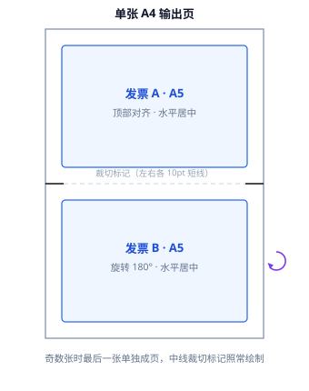

# MergeInvoice-web · 发票拼版工具

> 将两张 A5 版式发票自动拼版到单张 A4（第二张旋转 180°），页缘附裁切标记线。纯浏览器本地解析，文件数据不出本机。


---

## 效果示意



- 奇数张 A5 时，最后一张单独占一页，中线裁切标记照常绘制；
- A4 版式整页发票逐张输出（内容高度不足整页时底部附裁切线）；
- 数字签名与电子印章的**可视外观**在合并时烘焙进页面内容流，打印/分发所见即所得。

## 功能特性

| 类别 | 说明 |
| --- | --- |
| 批量导入 | 点击选择 / 拖拽导入，支持多选与多次追加 |
| 智能去重 | 基于内容哈希（SHA-256）检测重复文件，自动跳过 |
| 导入保护 | 单个 PDF **最多 10 页**，超出拒绝导入并明确提示 |
| 页管理 | 逐页缩略图预览，单页删除 / 恢复，统计与合并结果实时联动 |
| 顺序调整 | 导入列表与合并结果均支持**拖拽排序**（含边缘自动滚动） |
| 结果编辑 | 合并结果可删除单页、重排页面，下载与打印始终按当前预览输出 |
| 预览 | 卡片内自适应缩略图、点击放大弹窗、窗口缩放自动重渲染 |
| 打印 | 调起系统打印对话框（失败自动降级为图片模式） |
| 隐私 | 全程浏览器本地解析，**无任何网络上传**，文件数据不出本机 |

## 快速开始

```bash
# 环境要求：Node.js ≥ 20.19
git clone <repo-url> MergeInvoice-web
cd MergeInvoice-web
npm install

npm run dev        # 开发服务器，默认 http://localhost:5173
npm run build      # 生产构建 → dist/
npm run preview    # 本地预览构建产物
npm test           # 单元测试（node --test，18 个用例）
```

## 使用流程

1. **导入发票** —— 拖入或选择 PDF（可多选）。卡片上可翻页预览、点击「页」管理单页删除，拖拽卡片调整文件顺序；
2. **合并** —— 查看待合并清单（A5 / A4 / 跳过 / 已删 页数与预计输出张数），确认后一键合并；
3. **下载 / 打印** —— 结果页可继续删除单页或拖拽排序，然后下载 PDF 或调起系统打印。

## 拼版规则

- **页面分类**：取 MediaBox ∩ CropBox 有效盒；有效宽 > 615pt 判定为超出 A4 宽度而跳过；有效高 < 420.9445pt（A4 高度一半）判为 A5 横向发票，否则判为 A4 整页；
- **A5 两拼**：两页拼入同一张 A4 —— 第一页顶部对齐、水平居中；第二页旋转 180° 落于下半区；中线左右各绘制一段 10pt / 1pt 裁切标记线；
- **A4 整页**：一页占一张 A4、顶部对齐水平居中；仅当内容高度不足整页（`h + 50 < 页高`）时在内容底部绘制裁切线；
- **输出顺序**：所有 A5 页在前、A4 页在后，各自保持导入顺序；
- **文件命名**：`合并发票yyyyMMddHHmmss.pdf`。

## 技术架构

无框架纯 ES Modules 前端，Vite 构建：

```
MergeInvoice-web/
├── index.html              # 向导式三步骤界面（导入 → 合并 → 下载/打印）
├── vite.config.js          # base './' 相对路径部署 + pdf.js 运行时资源复制
├── src/
│   ├── main.js             # 全部 UI 状态与交互（导入/页管理/排序/结果编辑/打印）
│   ├── styles.css          # 自适应布局（宽屏至 1600px，窄屏可用）
│   └── modules/
│       ├── invoices.js     # 记录创建、页面分类、去重哈希、10 页导入上限
│       ├── merge.js        # 拼版规则（A5 两拼 / A4 整页 / 裁切标记）
│       ├── flatten.js      # 注解外观扁平化（印章/签名烘焙进内容流）
│       ├── preview.js      # pdf.js 渲染（自适应宽高、DPR、任务中止）
│       └── print.js        # 系统打印（原生优先，图片模式降级）
└── test/                   # node --test 单元测试与发票/印章夹具
```

| 组件 | 选型 | 用途 |
| --- | --- | --- |
| [pdf-lib](https://pdf-lib.js.org/) | ^1.17.1 | PDF 解析、注解扁平化、拼版合成、删页/重排 |
| [pdf.js](https://mozilla.github.io/pdf.js/) | ^5.7.284 | 页面渲染预览与打印图片降级 |
| [Vite](https://vite.dev/) | ^8.3.5 | 开发服务器与生产构建 |

## 打印建议

浏览器不提供本地打印机枚举接口，点击「打印」后请在系统对话框中选择目标打印机。推荐参数：

- 纸张：**A4**
- 缩放：**100% / 实际大小**
- 页边距：**无**

## 部署

`npm run build` 产物为纯静态文件（`dist/`，含 pdf.js 运行时资源），已配置相对路径（`base: './'`），可直接部署至任意静态托管（Nginx、对象存储、GitHub Pages、内网文件服务器等），无需任何后端服务。

## 浏览器支持与已知限制

- 需支持 PDF.js 与 ES Modules 的现代浏览器（推荐近两年版本的 Chrome / Edge / Firefox）；
- 加密 PDF 不做真实解密（仍尝试读取结构，内容渲染可能失败）；
- 仅处理注解的默认外观流（`/AP/N`），不处理外观状态字典；
- 页面合并不保留可交互表单与链接注解，仅保留印章/签名等可视外观。

## 隐私声明

所有解析、拼版、预览、打印均在浏览器本地完成，无后端接口，文件内容不会上传至任何服务器。

---

© 2026 Sharper 版权所有 · All Rights Reserved
